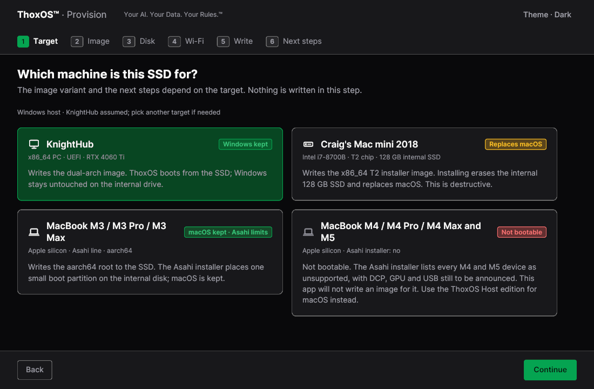
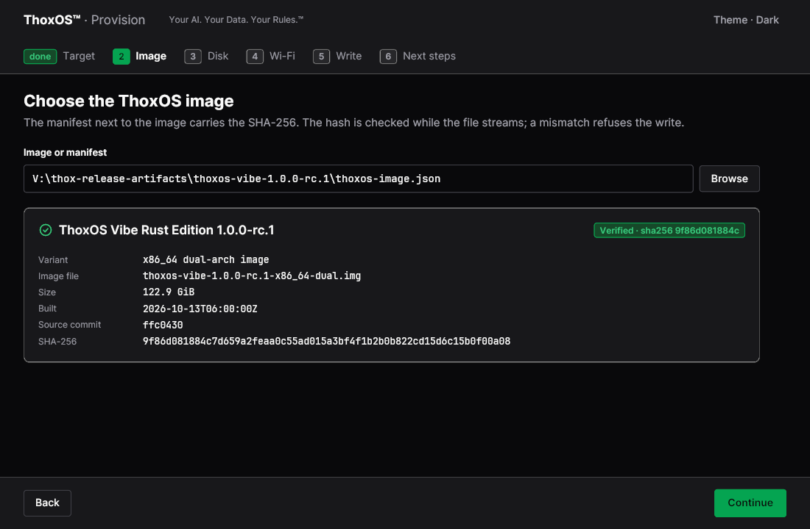
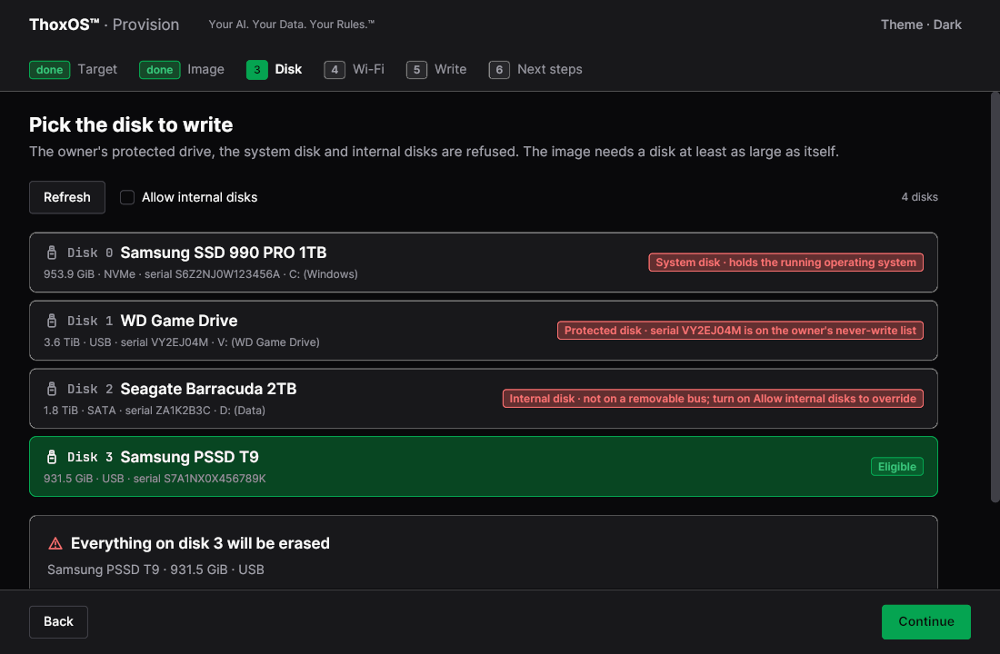
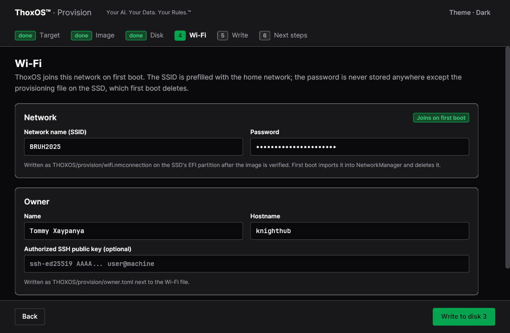
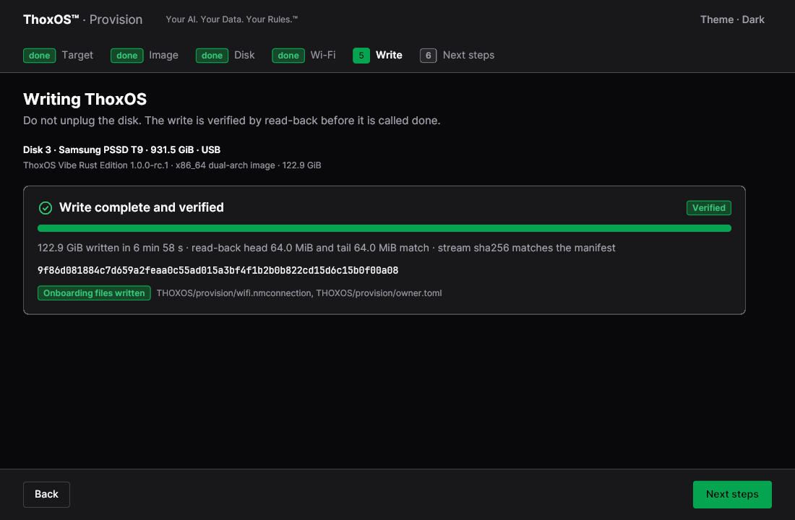
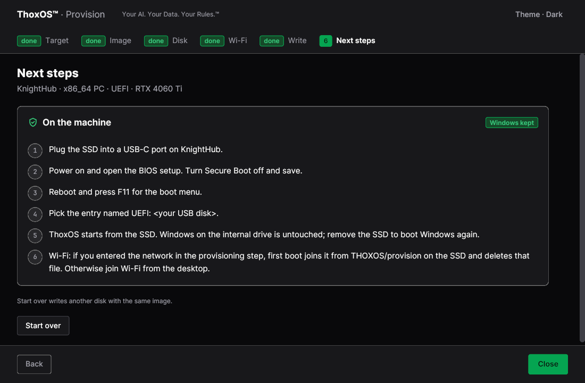
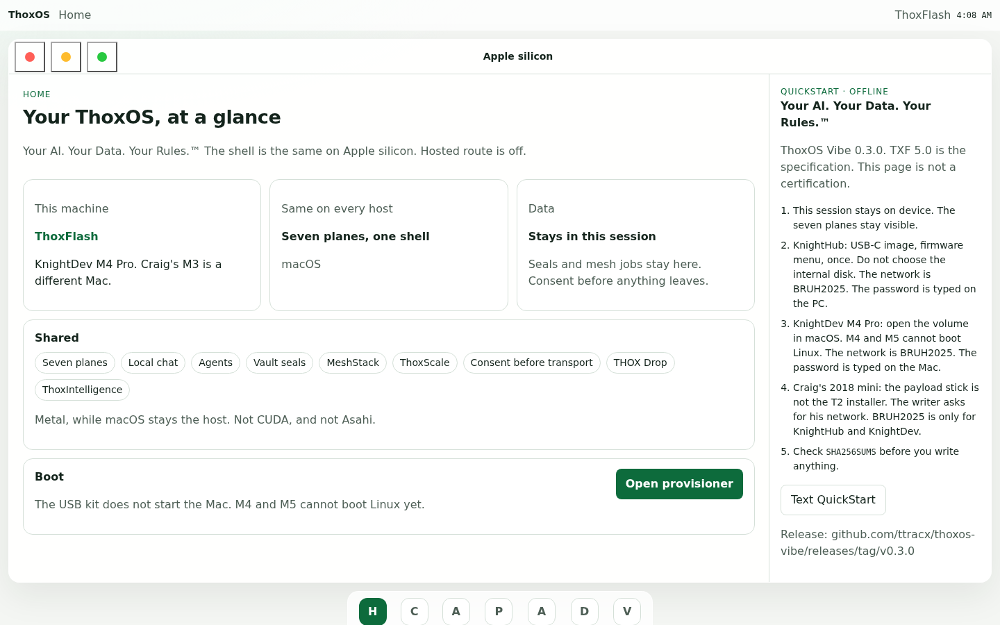

# Walkthrough A — Download and install

**What you will do:** download the ThoxOS release, check it, and write it to a
removable SSD with the ThoxOS Provision app. Provision does not install anything by
itself — it prepares the SSD your machine will boot from. The app has six steps, and
nothing is written to any disk until step 5.

**The three platform paths, in one paragraph each:**

- **Bare metal (64-bit x86 PC):** Provision writes the dual-arch image to a removable
  SSD. Boot the PC from that SSD (firmware boot menu) and ThoxOS runs from it; for a
  permanent dual-boot install alongside Windows, follow Team G's install guide — the
  approved layout keeps every Windows partition untouched and adds a second EFI.
- **Intel Mac (for example a 2018 Mac mini with a T2 chip):** Provision offers a
  dedicated x86_64 T2 installer target. On that path the install replaces macOS on the
  internal SSD — the app says so, in those words, before anything happens.
- **Apple silicon:** an M3-generation Mac can take the Asahi-line image with macOS
  kept. M4 and M5 Macs cannot boot this yet — the app refuses the target instead of
  failing halfway — and on those machines ThoxOS runs today as the host edition under
  macOS (figure A-07). A 64-bit virtual machine (the path Team F's VM image serves)
  boots the same image the VM frames in Walkthrough B were captured from.

Every screen below except A-07 is a **REAL** capture of the running Provision app.
Step numbers match the app's own step rail at the top of each screen.

---

## Step 1 — Pick the machine this SSD is for

**Label: REAL — the Provision app, step 1 of 6 (Target).**

1. The step rail. Six steps, in order: Target, Image, Disk, Wi-Fi, Write, Next steps. Nothing is written in this step.
2. The dual-boot target. ThoxOS boots from the SSD; Windows on the internal drive stays untouched.
3. The honest dead end. This MacBook generation cannot boot the image yet, so the app will not write one for it. It tells you here, not after an hour of copying.

*Plain English: you are telling the app which computer the SSD is for, because each kind of machine needs its own flavour of the system. If your machine cannot run it, the app stops you now.*

## Step 2 — Choose the image, and let it check itself

**Label: REAL — the Provision app, step 2 of 6 (Image).**

1. Point the app at the release's image file or its manifest — the small text file that travels with every download.
2. The green "Verified" tick. The manifest carries the image's SHA-256 fingerprint; the app checks it while the file streams, and a mismatch refuses the write.
3. What you picked, in plain sight: the variant, the file name, the size, and when it was built. Check the variant matches the target you chose in step 1.

*Plain English: before anything is copied, the app proves the download is complete and untampered-with, the same way Walkthrough B's terminal check does. Never write an image whose fingerprint does not match.*

## Step 3 — Pick the disk to write

**Label: REAL — the Provision app, step 3 of 6 (Disk).**

1. Refused, in red: the system disk. The app will not overwrite the system it is running on.
2. Refused, in red: a protected disk. The owner's never-write list is honoured without asking.
3. The one green row: an eligible removable SSD, big enough for the image. This is the only kind of row you can pick.
4. The warning, before you commit: everything on the chosen disk will be erased. Read the disk's name and size twice.

*Plain English: the app guards the dangerous choice. Your computer's own drive and any drive you have marked "never touch" cannot be selected at all — you can only pick a removable drive that fits the image.*

## Step 4 — Wi-Fi and owner details, written once

**Label: REAL — the Provision app, step 4 of 6 (Wi-Fi).**

1. Your home network name and password. ThoxOS joins this network on first boot, so you never type it on the new machine.
2. Your name and the machine's hostname, plus an optional SSH key if you use one.
3. The button says exactly what happens next: "Write to disk 3" — the disk you picked in step 3.

*Plain English: these details are written to a small provisioning file on the SSD, and first boot deletes that file after importing it. The Wi-Fi password is stored nowhere else.*

## Step 5 — The write, verified by reading it back

**Label: REAL — the Provision app, step 5 of 6 (Write), showing a completed write.**

1. "Verified." The write is not called done until it has been read back and compared.
2. How it was checked: the start and end of the disk were read back and matched, and the whole stream's SHA-256 matches the manifest from step 2.
3. The onboarding files from step 4 were written too — the Wi-Fi file and the owner file, named on screen.

*Plain English: the app writes the system, then reads the disk back to prove the copy is perfect. Do not unplug the disk during this step.*

## Step 6 — Next steps: booting the machine

**Label: REAL — the Provision app, step 6 of 6 (Next steps).**

1. The boot, in the app's own words: plug the SSD in, power on, open the firmware boot menu (F11 on this machine), and pick the entry named "UEFI: <your USB disk>".
2. "Windows kept." On the dual-boot path, removing the SSD boots Windows again exactly as before.
3. First boot joins the Wi-Fi you entered in step 4 and deletes the file that carried the password.

*Plain English: this screen is your checklist at the machine itself. What a real firmware menu and a real first boot look like is shown from the actual system in Walkthrough B — those frames come from the same image, booted in a virtual machine.*

## The Apple silicon path, on one page

**Label: SIMULATION — the TXF web preview page for the Apple silicon host edition. It is a design/specification page, not the running system.**

1. On Apple silicon the runtime is ThoxFlash, served on the Mac itself while macOS is the host.
2. The provisioner opens from this page; the USB kit does not start the Mac, and the page says why: M4 and M5 cannot boot Linux yet.
3. The offline QuickStart notes travel with the page, so the instructions work with no network.

*Plain English: if your Mac is Apple silicon, start here. Older silicon (M3 line) can also dual-boot the Asahi-line image from step 1; the newest machines run ThoxOS as a host edition today, and the app will tell you plainly which case you are in.*
