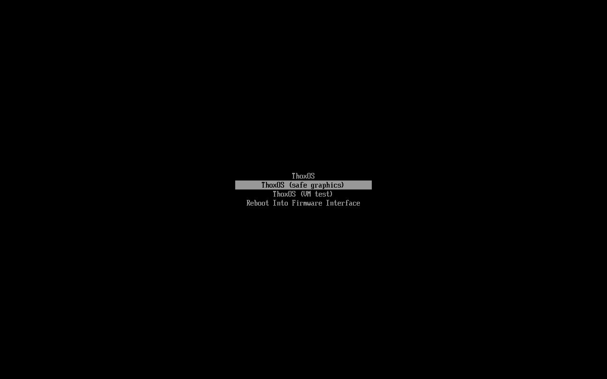
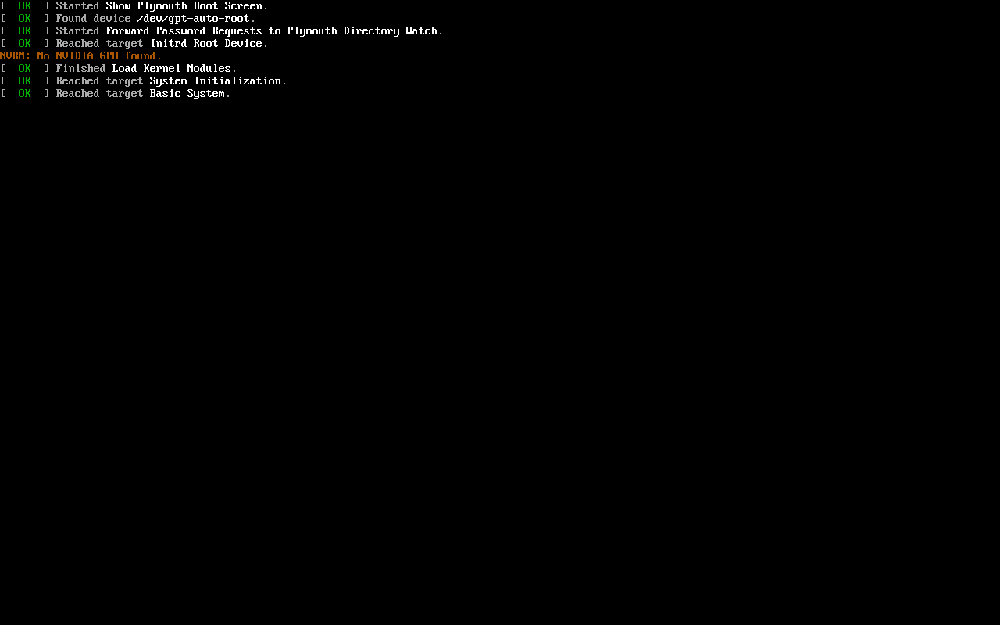
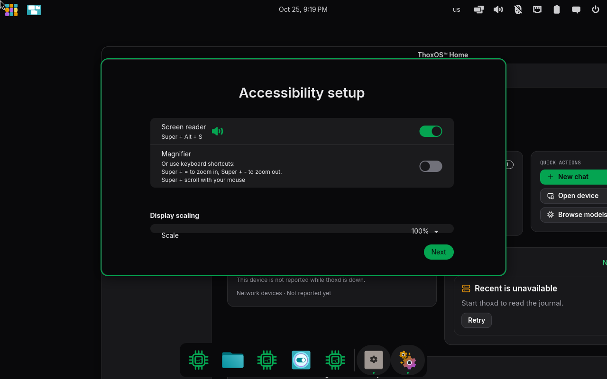
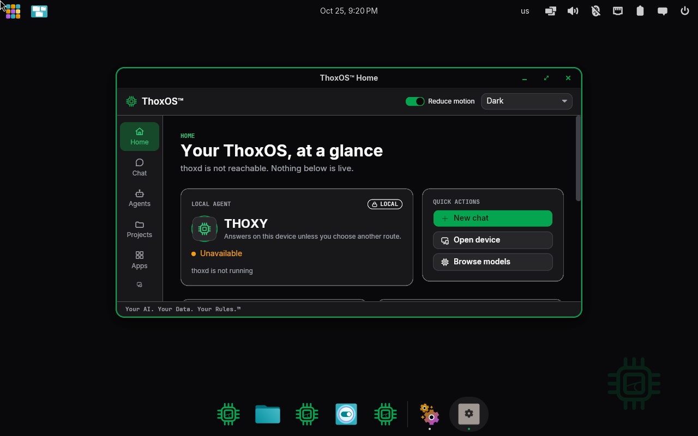
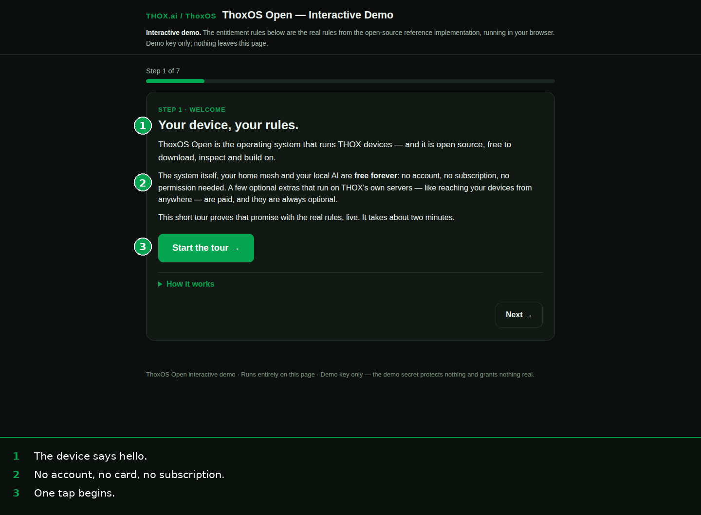
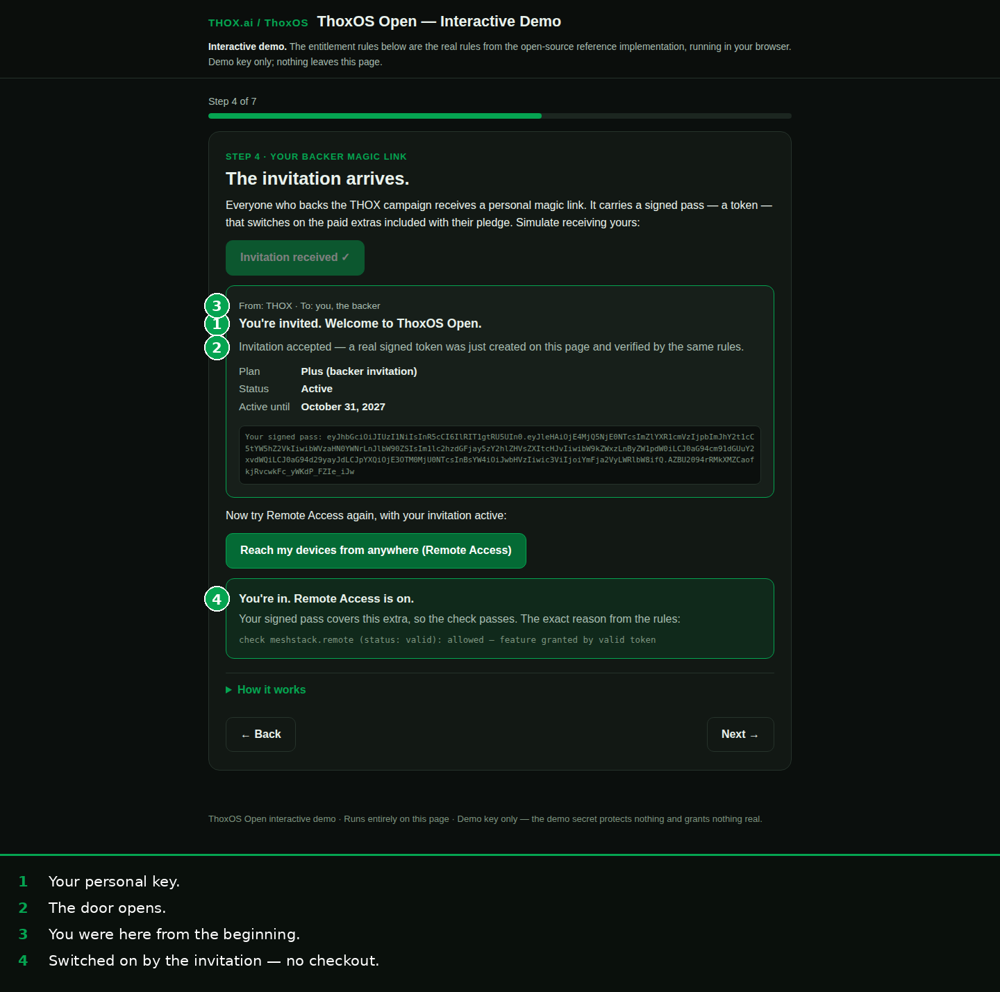
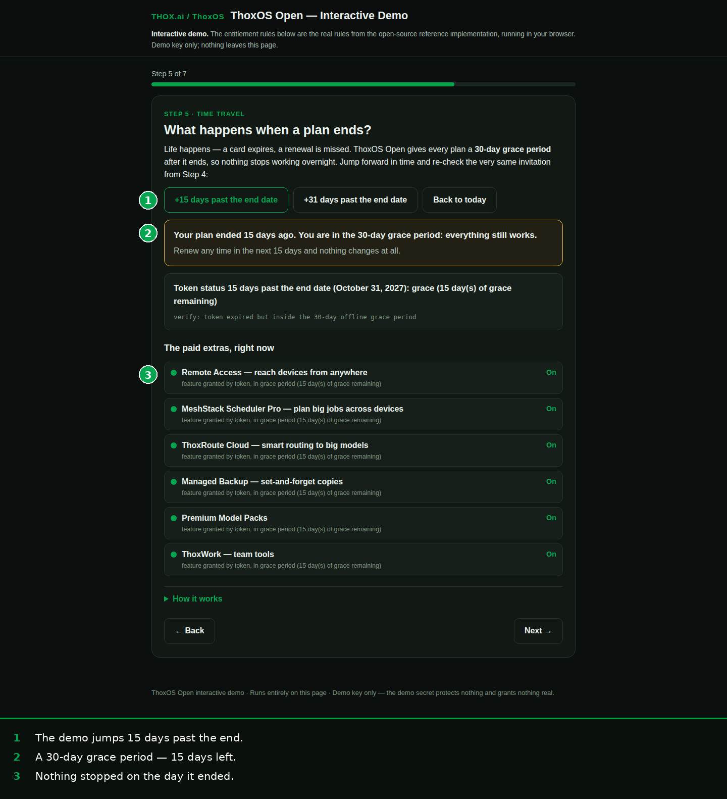
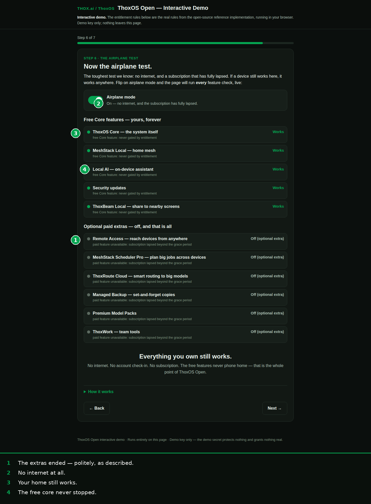

# Walkthrough B — First boot and entitlement activation

**Part 1 (figures B-01 to B-04)** is the real system booting: the current ThoxOS image
(1.0.0-rc.1, x86_64) starting in a virtual machine during the validation run of
2026-10-25. A virtual machine is not your hardware, and these frames are labelled for
exactly what they are — but every screen is the genuine system, not a drawing of it.

**Part 2 (figures B-05 to B-09)** is entitlement: how the optional paid extras are
switched on. ThoxOS itself is free and needs no account. The extras that use THOX's
computers (MeshStack Remote Access, hosted routes) are covered by a signed pass — a
token. Backers receive one as a personal magic link. The screens are the interactive
demo, which runs the real entitlement rules in your browser; figure numbers B-05 to
B-08 are the published user guide's demo steps 1, 4, 5 and 6, with the guide's own
callouts baked in.

---

## B-01 — The boot menu

**Label: REAL — the release image's boot menu (systemd-boot), captured in a VM.**

1. "ThoxOS" — the normal start. This is the entry a first boot uses.
2. "ThoxOS (safe graphics)" — the fallback if the display misbehaves, plus a VM-test entry and a door back into the firmware settings.

*Plain English: after the firmware menu in Walkthrough A, this is the first ThoxOS screen. Pick the top entry and wait.*

## B-02 — The system starting

**Label: REAL — early boot messages, captured in a VM.**

1. Green OK lines: the boot screen, the root device, and system initialisation all found and started.
2. The one orange line: "No NVIDIA GPU found." Expected inside a virtual machine, which has no such card. On the dual-boot hardware the driver payload is baked into the image, and this line does not appear.

*Plain English: a few seconds of plain text while the system wakes up. Green means go; the single orange line is the VM talking about itself, not a fault on real hardware.*

## B-03 — First-run setup: accessibility first

**Label: REAL — the first-run setup dialog over the desktop, captured in a VM.**

1. Before anything else, accessibility: screen reader and magnifier, with their keyboard shortcuts printed next to the switches.
2. The screen reader switch — set it now or later; the shortcuts (Super+Alt+S, Super and +/−) work either way.
3. Display scaling sits on the same screen, then "Next" carries on to the desktop behind the dialog.

*Plain English: the first thing a brand-new ThoxOS asks about is whether you need the screen read aloud or made bigger. Nothing is sold, tracked, or signed up for on this screen.*

## B-04 — The desktop, first minutes

**Label: REAL — the ThoxOS Shell home screen, captured in the VM minutes after boot.**

1. The local agent card: THOXY, marked LOCAL — answers on this device unless you choose another route.
2. Quick actions: start a chat, open the device page, browse models.
3. The honest status line. This frame was captured in the first minutes, while the background service (thoxd) was still starting — on this build it takes about two and a half minutes — and the shell says "not reachable" instead of pretending. When it is up, the same card shows the agent ready.

*Plain English: this is home. The row of icons down the left (Home, Chat, Agents, Projects, Apps, Devices, Vault) is the whole system; everything in Walkthrough D is one of those doors.*

## B-05 — Demo step 1: the welcome

**Label: SIMULATION — the interactive entitlement demo, guide step 1. Callouts are baked into the figure.**

The demo opens on the promise the rules have to keep: the device is yours, the free core is free forever, and no account, card, or subscription is asked for. "Start the tour" begins the seven steps.

*Plain English: this part of the walkthrough runs in a web page, on purpose — you can watch the entitlement rules behave before you ever install anything.*

## B-06 — Demo step 4: the invitation arrives (activation)

**Label: SIMULATION — the interactive entitlement demo, guide step 4. Callouts are baked into the figure.**

1. Your personal key: the backer magic link, from THOX, to you.
2. The door opens: accepting it creates and verifies a real signed pass on the spot — plan, status and expiry date printed on it.
3. You were here from the beginning: the invitation is the backer perk, carried by the pass itself.
4. Switched on by the invitation — no checkout: Remote Access, refused politely in step 3, is now on, and the screen shows the rule's own reason.

*Plain English: activation is not a licence key typed into a box. A signed pass arrives, the system checks the signature, and the extras it covers simply turn on — with the workings shown, not hidden.*

## B-07 — Demo step 5: fifteen days past the end (grace)

**Label: SIMULATION — the interactive entitlement demo, guide step 5. Callouts are baked into the figure.**

The demo jumps the clock 15 days past the end of the included period. The pass is in its 30-day grace period with 15 days left, and Remote Access is still on. Nothing stopped on the day the period ended.

*Plain English: if a subscription ever lapses, the extras do not cut out mid-sentence. There is a month of grace, and the screen tells you how much of it is left.*

## B-08 — Demo step 6: lapsed, and the aeroplane test

**Label: SIMULATION — the interactive entitlement demo, guide step 6. Callouts are baked into the figure.**

Past day 30 the extras switch off — politely, as described. Then the demo cuts the network entirely, and the free core carries on regardless: the home mesh still runs and local chat still answers.

*Plain English: this is the whole ThoxOS Open bargain in one screen. What you own outright never phones home, never expires, and never needs permission. Only the extras that spend THOX's money follow the pass.*

## B-09 — The same rules, as program output

**Label: REAL — verbatim output of the entitlement reference implementation**
([b-09-entitlement-terminal-output.txt](b-09-entitlement-terminal-output.txt)).

The demo above is a friendly face on this: the open-source reference implementation
issuing a pass, checking it, ageing it past expiry, and checking again. The lines that
matter:

- With a valid pass: `check meshstack.remote: allowed`, and `check core-os: allowed (free Core feature: never gated by entitlement)`.
- At expiry +15 days: `status: grace (grace days remaining: 15)` — the extra still allowed.
- At expiry +31 days: the extra is `denied`, and the same run then checks the free core one feature at a time — core OS, local AI, local mesh, security updates, local ThoxBeam — every one `allowed`.
- With no pass at all: free core allowed, paid extra denied.

*Plain English: the rule is mechanical, published, and testable — paid features follow the pass; the free core never does. Anyone can run this file and watch it happen.*
