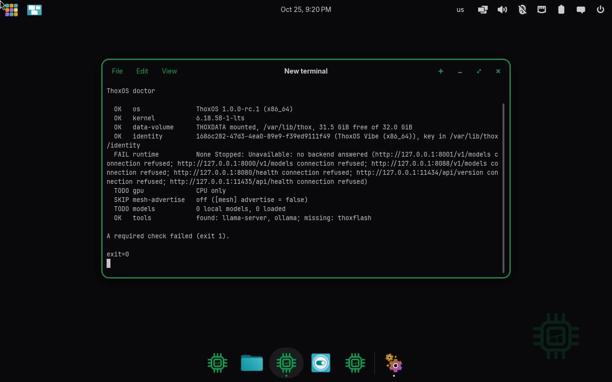
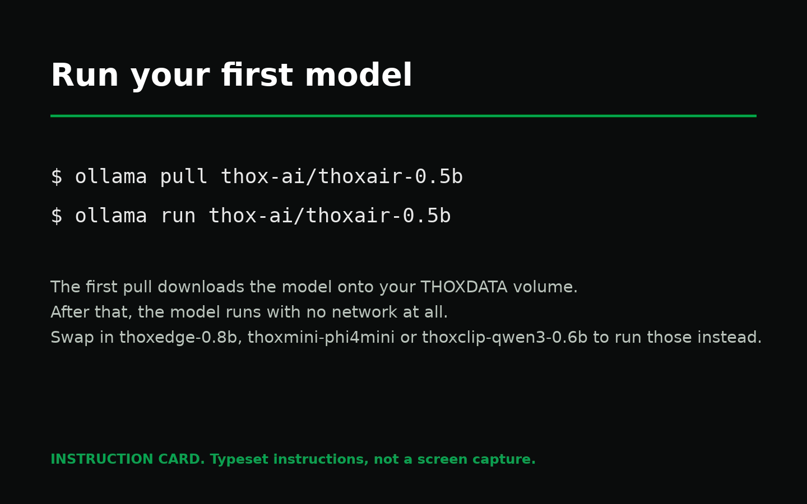
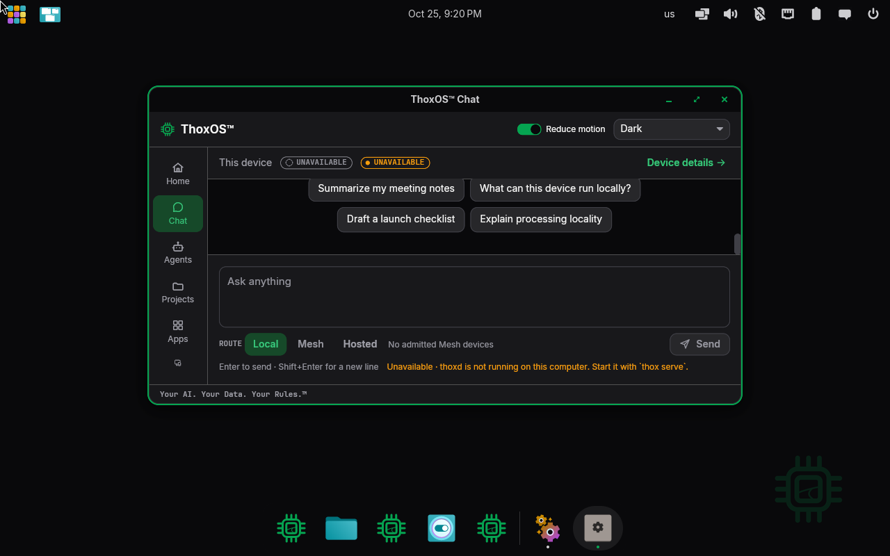
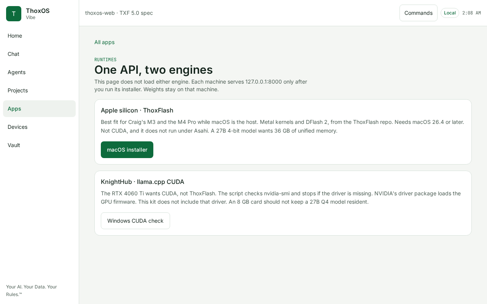

# Walkthrough C — Run your first model

**What you will do:** check the machine, fetch a model with one command, and ask it a
question. ThoxOS images ship with the engines installed and **no model on board by
design** — models are downloads you choose, stored on your THOXDATA volume, and they
run entirely on your own hardware. Figure C-01 shows the machine telling you exactly
that, in its own words, before you start.

---

## C-01 — Check the machine first: `thox doctor`



**Label: REAL — a terminal on the running system (VM capture), showing `thox doctor`.**

1. The foundations, all OK: ThoxOS 1.0.0-rc.1 (x86_64), the kernel, the THOXDATA volume mounted with room to spare, and this machine's own identity key.
2. The one failing line, and it is the point of this walkthrough: the runtime check fails because no model backend is running yet — "0 local models, 0 loaded." A fresh install is supposed to say this.
3. The tools are already here: `ollama` and `llama-server` are found on the machine. You install nothing to run a model; you only fetch the model itself.

*Plain English: `thox doctor` is the pre-flight check. Four green lines say the system is healthy; the red line is a shopping list of one item — a model — and the next figure is how you get it.*

## C-02 — The one command



**Label: INSTRUCTION CARD — typeset instructions, not a screen capture (it says so on its face).**

```bash
ollama pull thox-ai/thoxair-0.5b
ollama run thox-ai/thoxair-0.5b
```

The first line downloads ThoxAir-0.5B — the THOX flagship model for the ThoxAir tier
(GATE49 47/49, promoted) — onto your THOXDATA volume. The second line starts it. Swap
the name to run the others: `thox-ai/thoxedge-0.8b` (ThoxMini onboard, 46/49,
promoted), `thox-ai/thoxmini-phi4mini` (ThoxMini flagship, 47/49, documented
baseline), `thox-ai/thoxclip-qwen3-0.6b` (ThoxClip, grounding required). The same
models are on Hugging Face under the Thox-ai organisation if you prefer to fetch them
there. After the pull, no network is needed — the model answers from your machine,
which is the whole point of the demo's aeroplane test in Walkthrough B.

*Plain English: two lines in a terminal. The first is a download; the second is a conversation. A real capture of this exact session, on real hardware, is the first item in GAPS.md — it is shot the moment the release image exists, and this card stands in until then rather than a staged screenshot.*

## C-03 — Where the answer appears: Chat



**Label: REAL — the ThoxOS Shell Chat screen, captured in the VM.**

1. The route selector: **Local**, Mesh, Hosted. Local means this device answers. The choice is yours on every conversation, and Local is the default.
2. The prompt box and the starter questions — including, honestly, "What can this device run locally?"
3. The status line, kept honest: this frame was captured in the first minutes after boot, before the background service finished starting, so the screen says the device is unavailable rather than inventing an answer. With the model pulled (C-02) and the service up, this is the screen your answer lands on.

*Plain English: chat is one of the doors on the left rail. What matters is the small word under the box — Local — because it tells you whose computer is doing the thinking. Yours.*

## C-04 — Which engine runs it, per machine



**Label: SIMULATION — the TXF web preview page for runtimes. An explainer page, not the engine.**

1. Apple silicon: ThoxFlash, Metal-based, served on the Mac itself while macOS hosts.
2. A PC with an NVIDIA card: llama.cpp with CUDA, checked against the driver before it starts.
3. The page's own honesty line, at the top: "This page does not load either engine." One API, two engines; the weights stay on the machine that serves them.

*Plain English: you do not pick an engine. ThoxOS serves the same local API on each kind of machine and uses the engine that fits the hardware — ThoxFlash on Apple silicon, llama.cpp on CUDA PCs, Ollama on both.*
