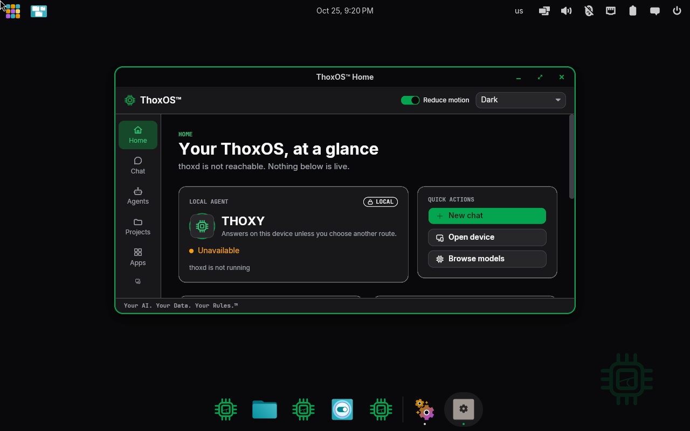
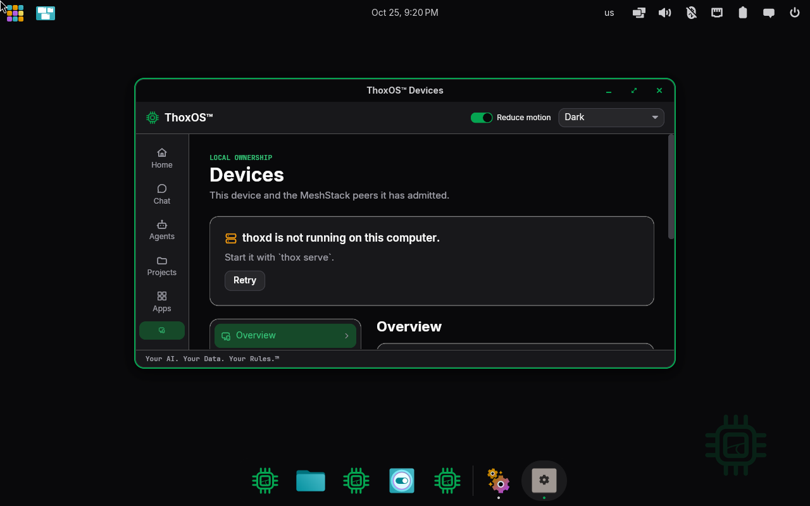
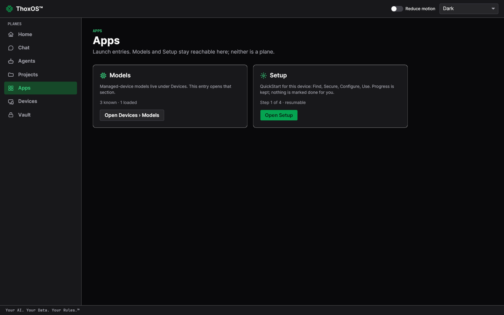
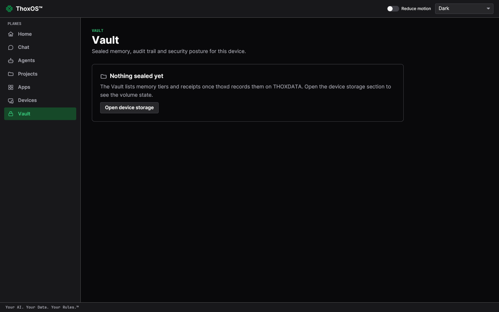
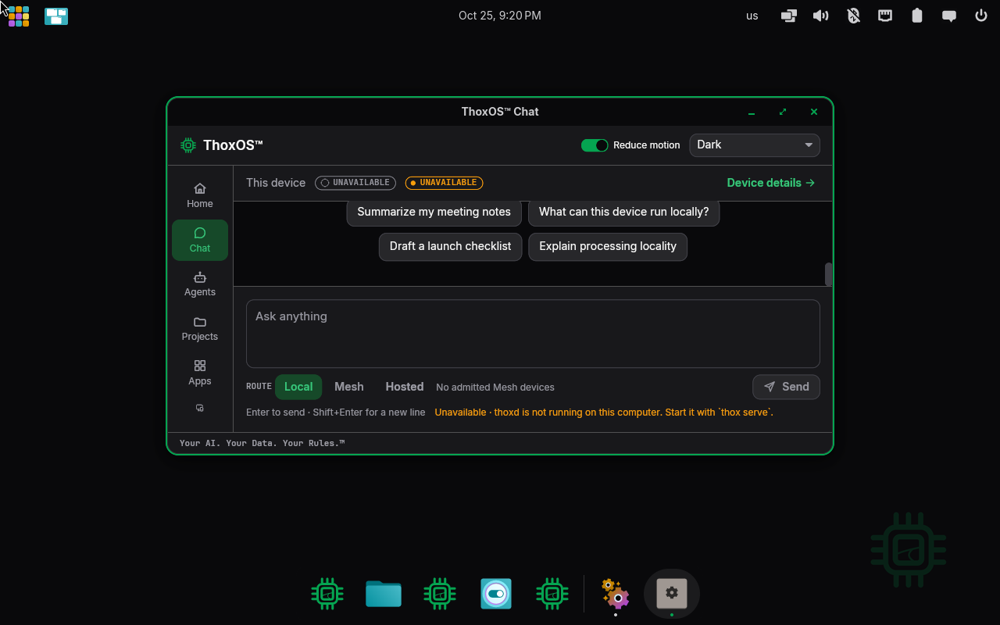
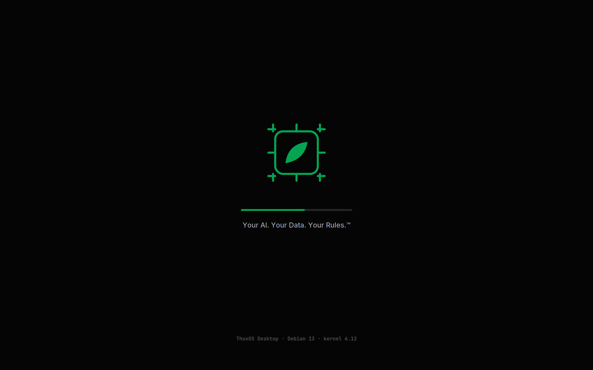
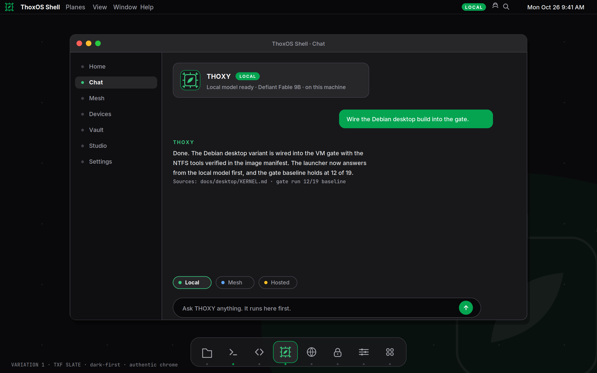

# Walkthrough D — ThoxOS desktop tour

Five stops on the real desktop (figures D-01 to D-05: the ThoxOS Shell running the
current image, captured in a virtual machine and as the compiled shell application),
then two design renders (D-06, D-07) that show where the visual design is heading —
labelled as drawings, because that is what they are.

The desktop is organised as **planes** — full-screen rooms down the left rail: Home,
Chat, Agents, Projects, Apps, Devices, Vault. One idea per room, and the tagline in
the footer of every room: *Your AI. Your Data. Your Rules.™*

---

## D-01 — Home: your ThoxOS, at a glance

**Label: REAL — the Shell home screen, VM capture.**

1. The local agent card: THOXY, with its LOCAL chip — the agent that answers on this device.
2. Quick actions: New chat, Open device, Browse models — the three things a first day actually does.
3. The rail: every plane of the system, one tap each. This walkthrough visits them in order.

*Plain English: home is a dashboard, not a desktop of scattered icons. It answers three questions at a glance: is my agent here, what can I do, and where is everything.*

## D-02 — Devices: what you own, and who it talks to

**Label: REAL — the Shell Devices screen, VM capture.**

1. The plain status card: on this capture the background service had not finished starting, and the page says so — with the exact command (`thox serve`) and a Retry button, not a spinner.
2. Devices in the rail: this device and the MeshStack peers it has admitted. Nobody joins your mesh uninvited; admission is the owner's act.
3. The Overview section below: storage and volume state for the device, once the service is reporting.

*Plain English: this room is the answer to "what machines are in my house, and are they mine?" When the service is up, each admitted device appears here with what it is pooling into the mesh.*

## D-03 — Apps: where Models and Setup live

**Label: REAL — the Shell Apps screen, compiled shell capture.**

1. Models: "3 known · 1 loaded" — the models on this device, managed under Devices. This entry opens that section.
2. Setup: the device's own QuickStart — Find, Secure, Configure, Use — with progress kept and resumable. Nothing is marked done for you.
3. The planes rail, complete: Home, Chat, Agents, Projects, Apps, Devices, Vault.

*Plain English: Apps is deliberately short. It is a doorway to the two things people come looking for — the models and the setup checklist — not another pile of icons.*

## D-04 — Vault: sealed memory and receipts

**Label: REAL — the Shell Vault screen, compiled shell capture.**

1. "Nothing sealed yet" — a fresh device's Vault is honestly empty. Sealed memory tiers and their receipts appear here as the background service records them on THOXDATA.
2. Vault in the rail: the room for the device's audit trail and security posture.

*Plain English: the Vault is where ThoxOS keeps its proofs — what was remembered, what was sealed, what left the device and when. Empty on day one is the correct first picture.*

## D-05 — Chat: the room you will live in

**Label: REAL — the Shell Chat screen, VM capture. (Same capture as Walkthrough C, figure C-03 — it earns its place in both.)**

1. Route chips under the prompt box: Local, Mesh, Hosted — whose computer answers, chosen per conversation.
2. Starter prompts that teach the system: summarise notes, draft a checklist, explain processing locality.
3. The footer that never changes: *Your AI. Your Data. Your Rules.™*

*Plain English: chat is where the models from Walkthrough C become useful. The route chips are the privacy model made visible — you can always see, and always choose, where an answer is computed.*

## D-06 and D-07 — The design direction (drawings, not the system)

**Label: SIMULATION — a drawn design render of a boot screen. Not a capture.**

The design studies for a quieter boot: the THOX mark, a progress line, the tagline.
The real boot, as it exists today, is Walkthrough B figures B-01 and B-02.

**Label: SIMULATION — a drawn design render ("Variation 1 · TXF Slate"). Not a capture.**

The Slate variation of the shell: planes on the left, the local agent's card at the
top, route chips — Local, Mesh, Hosted — under the conversation, and a dock below.
Anything that looks like a model answering in this drawing is part of the drawing.
Compare it with D-01 to D-05 to see how much of the design the running shell already
carries: the rail, the LOCAL chip, the routes, and the footer are all real today.

*Plain English: these two pictures are the target, pinned next to the reality on purpose. Where they differ, believe the captures.*
